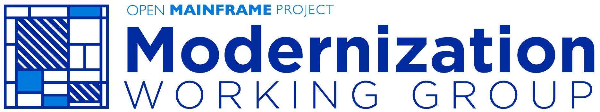

# Modernization Workgroup

**The Modernization Working Group** will create a common definition and framework around modernization in the mainframe space; produce educational material and promote all messages and definitions wider landscape for better alignment.

Goals of the WG are:
 
1. Formulate a standardized definition and framework for Mainframe Modernization to align industry expectations.
2. Produce high-quality educational materials, white papers, and reference architectures.
3. Foster collaboration and exchange of patterns among mainframe and hybrid-cloud practitioners.
 
Non-goals of the WG are:
 
1. Endorsing, promoting, or certifying specific vendor solutions or commercial modernization tools.
2. Developing or maintaining software codebases or SDKs (excluding documentation templates and scripts).
 
The TAC member sponsor of this working group is the TAC Chair.
 
## Deliverables
 
- [Mainframe Modernization Definition and Framework Document](modernization-definition.md)
- Reference architectures and educational materials (to be published in the `docs` folder)
 
## Communication
 
This WG communicates on the following channels:
 
- Subscribe to email list: https://lists.openmainframeproject.org/g/wg-mainframe-modernization
- Distribution list: wg-modernization@lists.openmainframeproject.org
- Slack channel: `#wg-mainframe-modernization` on the Open Mainframe Slack workspace
 
## Meetings
 
See the [Open Mainframe Project public calendar](https://calendar.openmainframeproject.org). This WG meets bi-weekly on Thursdays at 10:00 AM EST.
 
Zoom/conference call details: Check the public calendar invite or mailing list for the Zoom meeting link.
 
## In-person meetings
 
- Annual meeting at the Open Mainframe Summit and other co-located events.

## Meeting notes

Meeting notes, recordings, and any presentations made during WG meetings are available [here](meetings).
